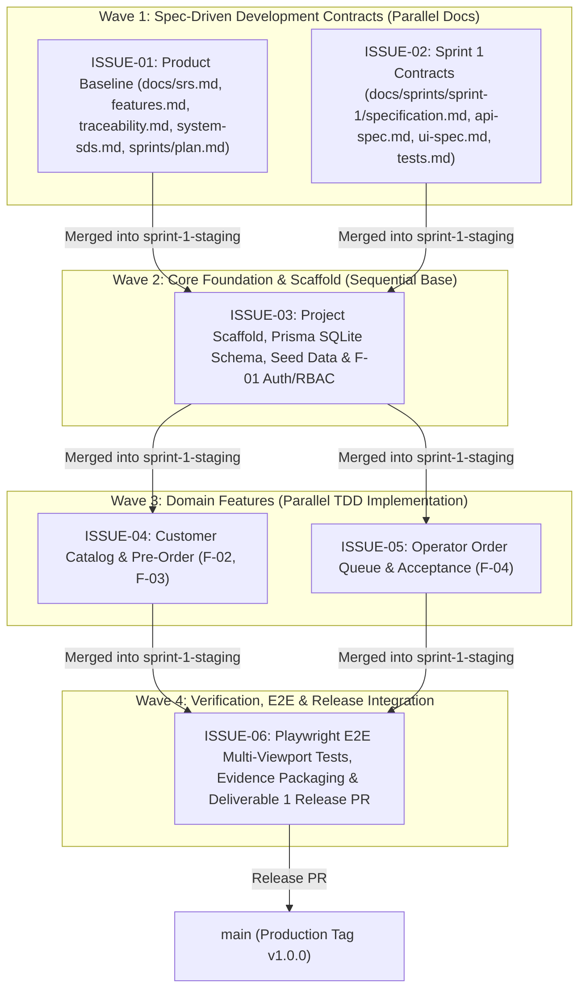
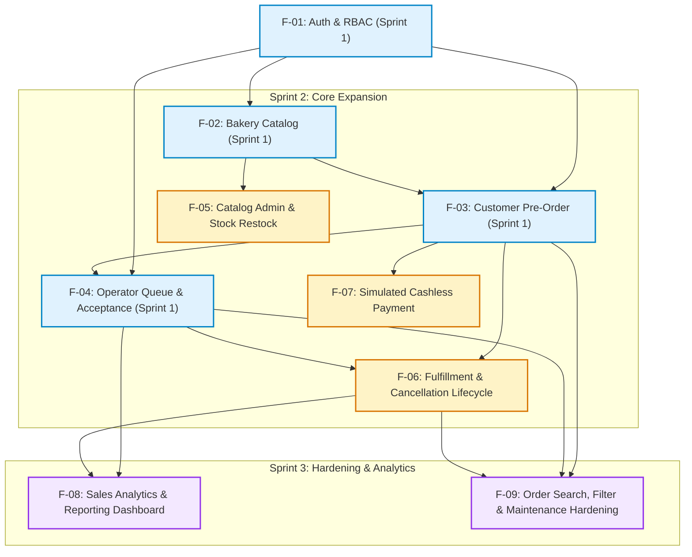

# Three-Sprint Master Plan & Delivery Roadmap

> **Course:** CPE 334 Introduction to Software Engineering in the Age of AI Agents (Semester 1/2026)  
> **System:** CrustCraft Artisan Bakery Pre-Order & Fulfillment System  
> **Document Version:** `1.0.0` (Sprint 1 Engineering Baseline)  
> **Authors & Co-Developers:**
> - Purin Mebotsom (Student ID: `67070507214`, GitHub: [`@meebotsompurin-stack`](https://github.com/meebotsompurin-stack), Role: `Co-Developer`)
> - Saksorn Buranatananun (Student ID: `67070507208`, GitHub: [`@poom2548`](https://github.com/poom2548), Role: `Co-Developer`)

---

## 1. Master Development & Assessment Roadmap

CrustCraft development progresses across three core engineering sprints aligned with the three major project deliverables and three group laboratory assessments.

| Cycle | Assessment / Deliverable | Due Date | Academic Weight | Allocated Features | Core Delivery Outcome |
|:---:|---|:---:|:---:|---|---|
| **Phase 0** | Repo Init & Governance Baseline | 31 Oct 2026 | — | Setup & Governance | Repository structure, plan documents, AI coding SOPs, and `ISSUE-00` |
| **Sprint 1** | **Project Deliverable 1** | **8 Nov 2026** | **80 pts (8%)** | **`F-01`, `F-02`, `F-03`, `F-04`** | **Engineering Baseline & Working Vertical Slice:** Spec DD contracts predating code, full auth, catalog, atomic customer pre-orders, and operator acceptance |
| Group Lab 5 | Lab 5: Containerization & Cloud CI/CD | 15 Nov 2026 | 100 pts (5%) | `F-01` to `F-04` (Deployed) | Docker containerization, automated GitHub Actions CI quality gates, and GCP deployment with persistent storage |
| Group Lab 6 | Lab 6: Cross-Team UAT & Defect Management | 22 Nov 2026 | 100 pts (5%) | `F-01` to `F-04` (Tested) | Formal cross-team user acceptance testing, defect reporting, triage, and regression-safe defect resolution |
| **Sprint 2** | **Project Deliverable 2** | **29 Nov 2026** | **70 pts (7%)** | **`F-05`, `F-06`, `F-07`** | **Core Expansion Increment:** Bakery catalog admin, complete fulfillment lifecycle, cancellation with stock restoration, and simulated payments |
| Group Lab 7 | Lab 7: Maintenance, Metrics & Release Readiness | 29 Nov 2026 | 100 pts (5%) | `F-09` (Maintenance) | Formal change impact analysis, test-first maintenance change implementation, and objective engineering metrics |
| **Sprint 3** | **Final Project Delivery** | **13 Dec 2026** | **100 pts (10%)** | **`F-08`, `F-09`** | **Complete Verified Release:** Sales analytics reporting, order filtering/search, final release packaging, report PDF, and demonstration video |

---

## 2. Sprint 1 Detailed Wave Execution Breakdown

Sprint 1 is engineered across four structured waves to allow Co-Developers Purin and Saksorn to develop in parallel on independent machines with zero merge conflicts:

### Sprint 1 Task Allocation & Responsibilities
- **Wave 1 (Pre-Code Contracts):**
  - `ISSUE-01` (`docs/issue-01-product-baseline`): Authored by Co-Developer 1 (Purin) and reviewed by Co-Developer 2 (Saksorn).
  - `ISSUE-02` (`docs/issue-02-sprint1-contracts`): Authored by Co-Developer 2 (Saksorn) and reviewed by Co-Developer 1 (Purin).
  - *Hard Stop:* Git timestamps on both PRs must demonstrably predate any implementation commits in Wave 2.
- **Wave 2 (Foundational Scaffolding):**
  - `ISSUE-03` (`feat/issue-03-scaffold-db-and-auth`): Establishes Express backend, React frontend, Prisma SQLite configuration with satang integer fields, seed accounts, and authentication middlewares.
- **Wave 3 (Parallel Feature Development):**
  - `ISSUE-04` (`feat/issue-04-customer-catalog-and-orders`): Implements `F-02` (Catalog) and `F-03` (Customer Orders with server-side total calculation, snapshotting, and atomic stock deduction).
  - `ISSUE-05` (`feat/issue-05-operator-order-acceptance`): Implements `F-04` (Shared Operator Queue and `PENDING` → `ACCEPTED` transition).
  - *Conflict Matrix Guard:* Zero overlapping routes, controllers, services, or page files. Shared files (`api.ts`, `App.tsx`) rebased cleanly.
- **Wave 4 (End-to-End Verification & Release):**
  - `ISSUE-06` (`test/issue-06-e2e-and-deliverable1-evidence`): Playwright E2E execution across Desktop (1280px), Tablet (768px), and Mobile (375px), automated screenshot capture, setup guide verification, and final Deliverable 1 Release PR creation.

---

## 3. Feature Dependency Network (F-01 to F-09)

The following dependency flowchart illustrates how subsequent sprints build upon the foundational contracts established in Sprint 1:

---

## 4. Sprint Completion Outcomes & Deliverables Definition

### 4.1 Sprint 1 Outcome (Deliverable 1 Checkpoint — 8 Nov 2026)
- **Code Deliverable:** Working web application deployed and running locally via `npm run dev`, with automated tests passing via `npm test` and `npm run test:e2e`.
- **Engineering Contracts:** Full Deliverable 1 Parts A–E documents committed to Git with immutable timestamps preceding code PRs.
- **Evidence Documentation:** Compiled PDF report containing system architecture diagrams, traceability matrix, test execution output, responsive layout screenshots, and cross-pair PR review logs.

### 4.2 Sprint 2 Outcome (Deliverable 2 Checkpoint — 29 Nov 2026)
- **Code Deliverable:** Expanded application incorporating catalog management, multi-stage order fulfillment, order cancellation with inventory recovery, and simulated payment transitions.
- **Cloud & UAT Artifacts:** Docker container running on GCP with persistent disk storage (Lab 5), accompanied by formal cross-team UAT defect evaluation and fix verification (Lab 6).

### 4.3 Sprint 3 Outcome (Final Project Delivery — 13 Dec 2026)
- **Code Deliverable:** Polished, production-ready release tagged on `main`, incorporating sales analytics dashboards, advanced search, and verified maintenance changes (Lab 7).
- **Submission Package:** Final comprehensive engineering report PDF, repository release reference, live GCP deployment URL, and a high-definition 10-minute demonstration video highlighting end-to-end domain journeys, access restrictions, and business rule enforcement.
