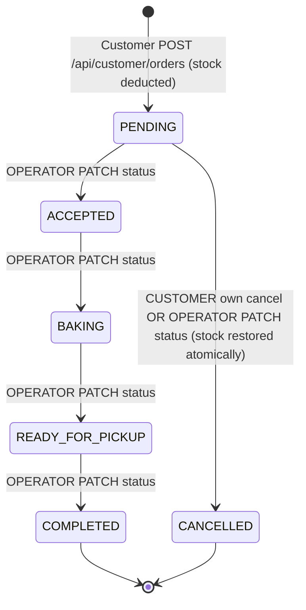

# Sprint 2 Feature Engineering Specification

> **Course:** CPE 334 Introduction to Software Engineering in the Age of AI Agents (Semester 1/2026)  
> **System:** CrustCraft Artisan Bakery Pre-Order & Fulfillment System  
> **Deliverable Section:** Deliverable 2 — Part B (Sprint 2 Feature-Level SDS & Contracts)  
> **Sprint 2 Status:** 🟡 Planned (Pre-Implementation Contracts Baseline — `S2-ISSUE-01` / `#61`)  
> **Authors & Co-Developers:**
> - Purin Mebotsom (Student ID: `67070507214`, GitHub: [`@meebotsompurin-stack`](https://github.com/meebotsompurin-stack), Role: `Co-Developer`)
> - Saksorn Buranatananun (Student ID: `67070507208`, GitHub: [`@poom2548`](https://github.com/poom2548), Role: `Co-Developer`)

---

## 1. Sprint Goal

Sprint 2 delivers the **Core Operational Expansion** of CrustCraft Artisan Bakery on top of the verified Sprint 1 vertical slice, Lab 5 PostgreSQL/GCP Cloud Run deployment, and Lab 6 defect resolution (`#58`). By the end of Sprint 2, bakery operators can administer the catalog (create products, adjust prices in integer satang, replenish daily batch stock, and archive/unarchive items), manage the full multi-stage order fulfillment lifecycle (`ACCEPTED` → `BAKING` → `READY_FOR_PICKUP` → `COMPLETED`), handle atomic order cancellations (`PENDING` → `CANCELLED` with automatic stock restoration), and track simulated cashless payment transitions (`UNPAID` → `PAID` | `FAILED`) alongside customers.

---

## 2. Scope

* **Included in Sprint 2:**
  * **F-05 (Bakery Catalog Administration):** Operator-only endpoints and management UI to view all catalog items (including `isAvailable: false`), create new bakery products, update descriptions/categories/prices (`Int` satang), replenish `stockQuantity`, and toggle `isAvailable`.
  * **F-06 (Order Fulfillment & Cancellation Lifecycle):** Full forward-only state machine for operators (`PENDING` → `ACCEPTED` → `BAKING` → `READY_FOR_PICKUP` → `COMPLETED`), plus `PENDING` → `CANCELLED` cancellation for owning customers (`BR-04`) and operators (`BR-06`) with atomic stock restoration inside `prisma.$transaction`.
  * **F-07 (Simulated Payment Transitions):** Persistent `Order.paymentStatus` (`UNPAID` | `PAID` | `FAILED`) backed by a PostgreSQL Prisma migration, customer simulated payment execution (`POST /api/customer/orders/:id/pay` supporting synthetic success & failure outcomes), and operator payment audit/update controls (`PATCH /api/operator/orders/:id/payment`).
* **Excluded from Sprint 2:**
  * Sales & Order Summary Reporting (`F-08` — Sprint 3, specified in `docs/sprints/sprint-3/` and implemented as Deliverable 2 Part C progress in `S2-ISSUE-04` / `#64`).
  * Multi-criteria order search/filtering (`F-09` — Sprint 3, deferred to remaining-work plan for 13 Dec Final Delivery).
  * Real external payment gateways (Stripe/Omise/PromptPay API) and courier delivery APIs (permanently out of scope per `docs/srs.md` §1.4).

---

## 3. Functional Requirements (FR)

### 3.1 F-05: Bakery Catalog Administration (`S2-ISSUE-03` / `#63`)
* **FR-05-01 (Create Bakery Item):** An authenticated `OPERATOR` can create a new catalog product via `POST /api/operator/catalog` with unique `name`, `description`, `price` (positive integer satang `> 0`), `stockQuantity` (integer `>= 0`), `category`, and optional `isAvailable` (defaults to `true`).
* **FR-05-02 (Manage & Restock Catalog Items):** An authenticated `OPERATOR` can inspect all catalog items (including archived items with `isAvailable == false`) via `GET /api/operator/catalog` and update any subset of `name`, `description`, `price`, `stockQuantity`, `category`, and `isAvailable` via `PATCH /api/operator/catalog/:id`.

### 3.2 F-06: Order Fulfillment & Cancellation Lifecycle (`S2-ISSUE-02` / `#62`)
* **FR-06-01 (Multi-Stage Fulfillment Progression):** An authenticated `OPERATOR` can advance an order sequentially through `PENDING` → `ACCEPTED` → `BAKING` → `READY_FOR_PICKUP` → `COMPLETED` via `PATCH /api/operator/orders/:id/status`. Skipping states, repeating a state, or moving backward MUST be rejected with `409 CONFLICT`.
* **FR-06-02 (Atomic Order Cancellation & Stock Restoration):**
  * An authenticated `CUSTOMER` can cancel their own `PENDING` order via `PATCH /api/customer/orders/:id/cancel` (`BR-04`).
  * An authenticated `OPERATOR` can cancel any `PENDING` order via `PATCH /api/operator/orders/:id/status` with `{ "status": "CANCELLED" }` (`BR-06`).
  * Both paths MUST execute inside a single `prisma.$transaction` using conditional state validation (`where: { id, status: "PENDING" }`) so concurrent cancellations cannot double-restore stock; each `OrderItem.quantity` is atomically incremented back onto `BakeryItem.stockQuantity`.

### 3.3 F-07: Simulated Payment Transitions (`S2-ISSUE-02` / `#62`)
* **FR-07-01 (Persistent Payment Status):** Every `Order` stores `paymentStatus` (`"UNPAID"` | `"PAID"` | `"FAILED"`), initialized to `"UNPAID"` on creation and returned in all order list/detail payloads.
* **FR-07-02 (Simulated Payment Execution & Audit):**
  * Owning `CUSTOMER` can invoke `POST /api/customer/orders/:id/pay` with optional `{ "simulateOutcome": "SUCCESS" | "FAIL" }` (defaults to `"SUCCESS"`) to transition `UNPAID` or `FAILED` → `PAID` or `FAILED`. Paying an already `PAID` order or a `CANCELLED` order MUST be rejected with `409 CONFLICT`.
  * Authenticated `OPERATOR` can update an order's `paymentStatus` via `PATCH /api/operator/orders/:id/payment` (`UNPAID` | `PAID` | `FAILED`) for counter settlement/audit (rejected with `409 CONFLICT` if order is `CANCELLED`).

---

## 4. Business Rules (BR) & State Machine

Sprint 2 preserves all Sprint 1 rules (`BR-01` through `BR-07`) and enforces the extended `BR-07` state machine plus payment invariants:



* **BR-02 Continuity (Historical Snapshot Immutability):** Changing `BakeryItem.price` via `F-05` MUST NEVER alter `OrderItem.unitPriceAtOrder` or `Order.totalAmount` on any previously created order.
* **BR-03 Extension (Atomic Stock Restoration):** Cancelling a `PENDING` order MUST atomically verify `status === "PENDING"`, transition to `CANCELLED`, and increment each `BakeryItem.stockQuantity` by `OrderItem.quantity` inside one `prisma.$transaction`. Double-cancellation under concurrent requests MUST fail with `409 CONFLICT` and zero duplicate stock restoration.
* **BR-05 Continuity (`isAvailable` vs. `stockQuantity`):** `GET /api/operator/catalog` exposes all items (`isAvailable: true` and `false`), whereas `GET /api/catalog` remains filtered to `isAvailable: true` only.
* **Payment Guard:** A `CANCELLED` order cannot transition to `PAID`; an already `PAID` order cannot be paid again via the customer pay endpoint (`409 CONFLICT`).

---

## 5. Authorization Matrix (RBAC) — Sprint 2 Additions

| Action | Method & Path | Unauth | `CUSTOMER` | `OPERATOR` | Rule / Ownership Constraint |
|---|---|:---:|:---:|:---:|---|
| List All Catalog Items (Admin) | `GET /api/operator/catalog` | ❌ `401` | ❌ `403` | ✔ `200` | Includes `isAvailable: false` items |
| Create Catalog Item | `POST /api/operator/catalog` | ❌ `401` | ❌ `403` | ✔ `201` | `price > 0` integer satang; unique `name` |
| Update / Restock Catalog Item | `PATCH /api/operator/catalog/:id` | ❌ `401` | ❌ `403` | ✔ `200` | Does not mutate historical order prices (`BR-02`) |
| Advance / Cancel Order (Operator) | `PATCH /api/operator/orders/:id/status` | ❌ `401` | ❌ `403` | ✔ `200` | Strict `ALLOWED_TRANSITIONS` (`BR-07`) |
| Cancel Own Pending Order | `PATCH /api/customer/orders/:id/cancel` | ❌ `401` | ✔ `200` / `403` | ❌ `403` | Own order only (`BR-04`) & `PENDING` only (`409`) |
| Simulate Customer Payment | `POST /api/customer/orders/:id/pay` | ❌ `401` | ✔ `200` / `403` | ❌ `403` | Own non-cancelled order (`BR-04`); `409` if `PAID`/`CANCELLED` |
| Operator Payment Update / Audit | `PATCH /api/operator/orders/:id/payment` | ❌ `401` | ❌ `403` | ✔ `200` | `409` if order is `CANCELLED` |

---

## 6. Data Model Changes (`prisma/schema.prisma`)

Database engine: **PostgreSQL 16** (established in Lab 5). One additive, backward-compatible migration is introduced in `S2-ISSUE-02`:

```prisma
model Order {
  id            String      @id @default(cuid())
  customerId    String
  customer      User        @relation(fields: [customerId], references: [id])
  status        String      @default("PENDING") // PENDING | ACCEPTED | BAKING | READY_FOR_PICKUP | COMPLETED | CANCELLED
  paymentStatus String      @default("UNPAID")  // UNPAID | PAID | FAILED (NEW in Sprint 2 — F-07)
  totalAmount   Int         // Authoritative server-calculated total in integer satang (BR-01)
  pickupNote    String?     // Max 500 chars (enforced since Lab 6 #58)
  items         OrderItem[]
  createdAt     DateTime    @default(now())
  updatedAt     DateTime    @updatedAt

  @@index([customerId])
  @@index([status, createdAt])
}
```

- **No changes to `User`, `BakeryItem`, or `OrderItem` tables:** `BakeryItem` already includes `name`, `description`, `price`, `stockQuantity`, `isAvailable`, and `category` required by `F-05`.
- **Migration Safety:** Adding `paymentStatus TEXT NOT NULL DEFAULT 'UNPAID'` cleanly backfills all existing orders on Cloud SQL without data loss or downtime.

---

## 7. Acceptance Criteria (AC)

### 7.1 F-05: Bakery Catalog Administration
* **AC-S2-F05-01 (`ADM-01`):** `POST /api/operator/catalog` with valid payload persists a new `BakeryItem` (`price` in integer satang) and returns `201 Created`.
* **AC-S2-F05-02 (`ADM-02`, `ADM-03`):** `PATCH /api/operator/catalog/:id` updates price, description, category, `stockQuantity` (restock), and/or `isAvailable` and returns `200 OK`.
* **AC-S2-F05-03 (`ADM-04`):** `GET /api/operator/catalog` returns all items regardless of `isAvailable`, while `GET /api/catalog` continues returning only `isAvailable == true`.
* **AC-S2-F05-04 (`ADM-05`):** Invalid values (`price <= 0`, non-integer `price`, `stockQuantity < 0`, blank `name`) return `400 VALIDATION_ERROR`; duplicate `name` returns `409 CONFLICT`; unknown ID returns `404 NOT_FOUND`.
* **AC-S2-F05-05 (`ADM-06`):** Unauthenticated requests return `401`; `CUSTOMER` requests to `/api/operator/catalog*` return `403 FORBIDDEN`.
* **AC-S2-F05-06 (`ADM-07`):** Updating `BakeryItem.price` leaves `OrderItem.unitPriceAtOrder` and `Order.totalAmount` unchanged on existing orders (`BR-02`).
* **AC-S2-F05-07 (`ADM-08`):** Setting `isAvailable: false` removes item from public catalog and rejects new orders with `409 CONFLICT`; restocking `stockQuantity` from `0` to `> 0` re-enables ordering.
* **AC-S2-F05-08:** `/operator/catalog` UI supports creating, editing, restocking, and toggling availability across Desktop/Tablet/Mobile viewports.

### 7.2 F-06: Order Fulfillment & Cancellation Lifecycle
* **AC-S2-F06-01 (`FUL-01`, `FUL-02`):** `PATCH /api/operator/orders/:id/status` advances `PENDING` → `ACCEPTED` → `BAKING` → `READY_FOR_PICKUP` → `COMPLETED` sequentially and rejects skipped/backward/repeated transitions with `409 CONFLICT`.
* **AC-S2-F06-02 (`FUL-03`, `FUL-04`):** `PATCH /api/customer/orders/:id/cancel` cancels an owning customer's `PENDING` order (`status = "CANCELLED"`) and atomically restores all ordered line-item quantities to `BakeryItem.stockQuantity`.
* **AC-S2-F06-03 (`FUL-05`):** Cancelling another customer's order returns `403 FORBIDDEN`; cancelling an order not in `PENDING` state returns `409 CONFLICT` with zero stock change.
* **AC-S2-F06-04 (`FUL-06`, `FUL-07`):** `PATCH /api/operator/orders/:id/status` with `{ "status": "CANCELLED" }` on a `PENDING` order cancels it and restores stock atomically; attempting to cancel `ACCEPTED` or later returns `409 CONFLICT`.
* **AC-S2-F06-05 (`FUL-08`):** Operator queue prioritizes active statuses (`PENDING` → `ACCEPTED` → `BAKING` → `READY_FOR_PICKUP` → `COMPLETED` → `CANCELLED`), and UI exposes context-appropriate action buttons.

### 7.3 F-07: Simulated Payment Transitions
* **AC-S2-F07-01 (`PAY-01`):** Every new order initializes with `paymentStatus: "UNPAID"` and exposes `paymentStatus` in all order responses.
* **AC-S2-F07-02 (`PAY-02`, `PAY-03`):** `POST /api/customer/orders/:id/pay` transitions owning customer's order from `UNPAID`/`FAILED` → `PAID` (default) or `FAILED` (`simulateOutcome: "FAIL"`), and allows retry from `FAILED` → `PAID`.
* **AC-S2-F07-03 (`PAY-04`, `PAY-05`):** Paying another customer's order returns `403 FORBIDDEN`; paying a `CANCELLED` or already `PAID` order returns `409 CONFLICT`.
* **AC-S2-F07-04 (`PAY-06`, `PAY-07`):** `PATCH /api/operator/orders/:id/payment` updates payment status for non-cancelled orders (`OPERATOR` only; `CUSTOMER` gets `403 FORBIDDEN`; `CANCELLED` order gets `409 CONFLICT`).
* **AC-S2-F07-05:** Customer & Operator Order Detail views render `PaymentStatusBadge` and `SimulatedPaymentCard`.

---

## 8. Product Definition of Done (Sprint 2 DoD)
* [ ] All Sprint 2 contracts (`specification.md`, `api-spec.md`, `ui-spec.md`, `tests.md`) merged into `sprint-2-staging` BEFORE implementation commits.
* [ ] All Sprint 2 AC (`AC-S2-F05-01`..`08`, `AC-S2-F06-01`..`05`, `AC-S2-F07-01`..`05`) implemented and verified by passing automated tests (TDD Red → Green preserved in Git history).
* [ ] Zero regressions in Sprint 1 (44 tests) and Lab 6 (`#58` `pickupNote` 500-char tests).
* [ ] Every feature PR passes CI (`test-and-docker`) and receives substantive peer review from the teammate.
* [ ] Integrated release candidate deployed on GCP Cloud Run via repeatable pipeline and verified post-deployment.
