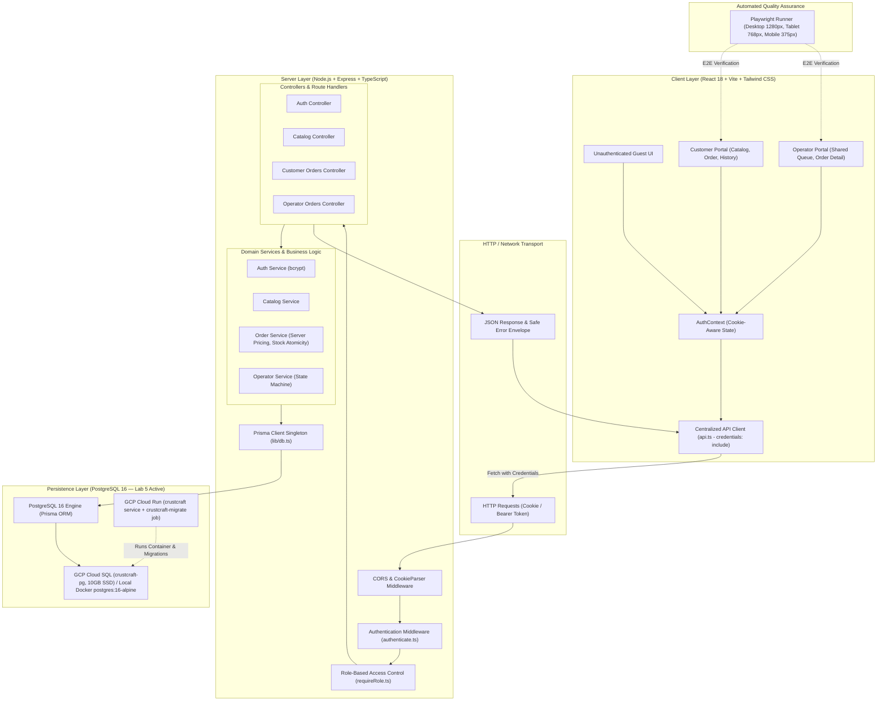
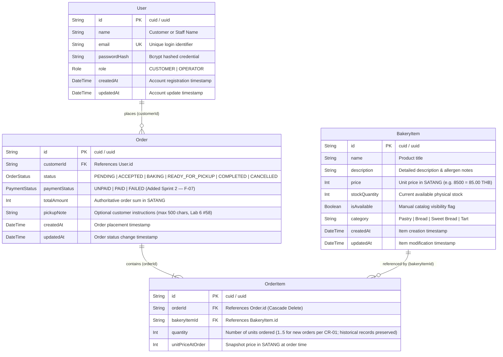

# System-Level Software Design Specification (System SDS)

> **Course:** CPE 334 Introduction to Software Engineering in the Age of AI Agents (Semester 1/2026)  
> **System:** CrustCraft Artisan Bakery Pre-Order & Fulfillment System  
> **Document Version:** `2.0.1` (Sprint 2 Baseline Sync + Lab 7 `CR-01` Maintenance Revision — updated for Lab 5 PostgreSQL 16 / Cloud Run / WIF CI/CD, Sprint 2 `Order.paymentStatus`, and Lab 7 `CR-01` `ADR-06`)  
> **Authors & Co-Developers:**
> - Purin Mebotsom (Student ID: `67070507214`, GitHub: [`@meebotsompurin-stack`](https://github.com/meebotsompurin-stack), Role: `Co-Developer`)
> - Saksorn Buranatananun (Student ID: `67070507208`, GitHub: [`@poom2548`](https://github.com/poom2548), Role: `Co-Developer`)

### Revision History
| Version | Date | Issue / PR | Summary of Changes |
|---|---|---|---|
| `1.0.0` | 2026-11-01 | Sprint 1 Baseline (`v1.0.0-sprint1`) | Initial System SDS covering Modular Monolith architecture, security protocol, ER model, tech stack, and `ADR-01`–`ADR-05`. |
| `1.1.0` | 2026-11-24 | Lab 7 `CR-01` (`#74` / `LAB7-ISSUE-01`) | Updated Request Lifecycle (§3.1) and ER model annotation (§4.1) for pre-transaction `1 <= quantity <= 5` cap, duplicate `bakeryItemId` `400` rejection, `400`-before-`409` precedence, and added `ADR-06`. Zero Prisma schema/migration changes. |
| `2.0.0` | 2026-11-24 | Sprint 2 Baseline (`v2.0.0-sprint2`, `#61`–`#63`) | Synced architecture diagrams, PostgreSQL 16 / Cloud Run `ADR-01`, and `Order.paymentStatus` (`F-07`). |
| `2.0.1` | 2026-11-24 | Lab 7 Release Sync (`v2.0.1-lab7`, `#75`) | Integrated Lab 7 `CR-01` (`v1.1.0` / `ADR-06`) with Sprint 2 (`v2.0.0-sprint2`). |

---

## 1. System Architecture Overview

CrustCraft is engineered as a **Modular Monolith** full-stack web application. The design separates concerns into clean, maintainable logical boundaries while retaining a single repository and cohesive deployment unit, perfectly suited for rapid containerization and cloud orchestration under Google Cloud Platform (GCP).

### 1.1 Architecture Diagrams

#### Mermaid System Topology Diagram


#### ASCII Architecture Diagram
```text
+-----------------------------------------------------------------------------------------+
|                                CLIENT LAYER (React 18 + Vite)                           |
|  [Guest Catalog View]   [Customer Order View]   [Operator Shared Queue View]            |
|                              |                           |                              |
|                              +------------+--------------+                              |
|                                           |                                             |
|                                  [AuthContext.tsx]                                      |
|                                           |                                             |
|                             [services/api.ts (credentials: include)]                   |
+-------------------------------------------|---------------------------------------------+
                                            | HTTP (JSON / Cookies)
+-------------------------------------------v---------------------------------------------+
|                                SERVER LAYER (Express.js + TypeScript)                   |
|  [cors, cookie-parser, express.json]                                                    |
|         |                                                                               |
|  [authenticate.middleware.ts] ------> (Extracts JWT: req.cookies.token || Bearer)       |
|         |                                                                               |
|  [requireRole.middleware.ts] -------> (Enforces: CUSTOMER vs OPERATOR)                  |
|         |                                                                               |
|  +------+-------------------+--------------------+--------------------+                 |
|  | auth.controller.ts       | catalog.controller | orders.controller  | operator.ctrl   |
|  | auth.service.ts          | catalog.service.ts | orders.service.ts  | operator.svc    |
|  +--------------------------+--------------------+--------------------+-----------------+
|                                           |                                             |
|                                [server/src/lib/db.ts] (Prisma Singleton)                |
+-------------------------------------------|---------------------------------------------+
                                            | Prisma ORM (Engine)
+-------------------------------------------v---------------------------------------------+
|                               PERSISTENCE & STORAGE LAYER                               |
|       Prod: GCP Cloud SQL for PostgreSQL 16 (crustcraft-pg via Unix Socket / Cloud Run) |
|       Local / CI: Docker Compose postgres:16-alpine with named persistent volume        |
+-----------------------------------------------------------------------------------------+
```

---

## 2. Component Breakdown & Boundaries

The codebase is organized into four strictly segregated directories, preventing coupling between client presentation, backend domain logic, database operations, and testing harnesses:

```text
crustcraft-bakery-order/
├── client/                     # Frontend Application (React + Vite + Tailwind CSS)
│   ├── src/
│   │   ├── components/         # Reusable presentation widgets (BakeryItemCard, Navbar, etc.)
│   │   ├── context/            # Global application state (AuthContext.tsx)
│   │   ├── pages/              # Routed view containers (CatalogPage, OrderPage, QueuePage)
│   │   ├── services/           # Centralized API network client (api.ts)
│   │   ├── App.tsx             # Route definitions & protected route wrappers
│   │   └── main.tsx            # DOM initialization
│   └── package.json
├── server/                     # Backend API & Domain Logic (Express + TypeScript)
│   ├── src/
│   │   ├── controllers/        # HTTP input parsing, validation & response envelope mapping
│   │   ├── middleware/         # Auth verification, role guards & error handlers
│   │   ├── routes/             # Namespaced route definitions (auth, catalog, customer, operator)
│   │   ├── services/           # Pure business logic (stock validation, pricing, transactions)
│   │   ├── lib/db.ts           # Shared PrismaClient singleton instance
│   │   ├── app.ts              # Express application assembly & middleware chain
│   │   └── server.ts           # HTTP network listener initialization
│   └── package.json
├── prisma/                     # Database Schema, Migrations & Synthetic Seed Data
│   ├── schema.prisma           # Relational schema specification
│   ├── migrations/             # Versioned schema migration SQL histories
│   └── seed.ts                 # Idempotent baseline data seeder
└── e2e/                        # Automated End-to-End Test Suite (Playwright)
    ├── sprint-1/               # User journeys across Desktop, Tablet, and Mobile
    ├── screenshots/            # Verified responsive layout evidence captures
    └── playwright.config.ts    # Multi-browser & multi-viewport test configuration
```

---

## 3. End-to-End Data Flow & Security Protocol

### 3.1 Request Lifecycle & Credential Resolution
1. **Client Dispatch:** The React frontend invokes helper methods in `client/src/services/api.ts`. All outbound network requests include `credentials: 'include'`, automatically attaching the browser's stored `httpOnly` cookie (`token`).
2. **Cookie Parsing:** The Express server processes incoming requests through `cookie-parser`.
3. **Authentication Guard (`authenticate.middleware.ts`):**
   - The middleware inspects `req.cookies.token`. If present, it validates the JWT signature and expiration against the server's `JWT_SECRET`.
   - If the cookie is absent, it falls back to parsing the `Authorization: Bearer <token>` HTTP header, enabling automated API testing via Supertest without simulated browser cookie jars.
   - If valid, the user identity is attached to `req.user = { userId: string, role: Role }`. If invalid or expired, the request is terminated with `401 UNAUTHORIZED`.
4. **Authorization Guard (`requireRole.middleware.ts`):**
   - Endpoints requiring specific privileges apply `requireRole(['OPERATOR'])`. If `req.user.role` does not match, execution halts with `403 FORBIDDEN`.
5. **Pre-Transaction Domain Validation & Persistence (`CR-01` / `BR-03`):** The controller invokes the appropriate service. For `POST /api/customer/orders`, `orders.service.ts::createCustomerOrder()` executes all input and domain validation **before** opening `prisma.$transaction`:
   - Non-empty `items[]`, valid `pickupNote` (`<= 500` chars per Lab 6 `#58`), and valid non-null item objects.
   - Unique `bakeryItemId` enforcement (`seenItemIds` set): duplicate entries in `items[]` fail immediately with `400 VALIDATION_ERROR` (`details[0].field === "items[<index>].bakeryItemId"`).
   - Quantity bounds enforcement (`1 <= quantity <= 5`, `MAX_QUANTITY_PER_ITEM = 5`): `quantity <= 0` or `quantity > 5` fails immediately with `400 VALIDATION_ERROR` (`details[0].field === "items[<index>].quantity"`).
   - **Precedence (`400` before `409`):** Input/domain validation completes before DB lookup, guaranteeing `400 VALIDATION_ERROR` precedes `409 CONFLICT` whenever `quantity > 5` and `quantity > stockQuantity` occur simultaneously.
   - Only after pre-transaction validation passes does the service open `prisma.$transaction` to verify existence (`404`), `isAvailable` (`409`), stock sufficiency (`409`), atomic stock deduction, and `Order`/`OrderItem` persistence.
6. **Error Envelope Normalization:** If validation fails or a business conflict occurs, the server responds using the mandatory standard error format (including indexed `details[].field` paths such as `items[0].quantity` or `items[1].bakeryItemId` for array validation errors):
   ```json
   {
     "error": {
       "code": "VALIDATION_ERROR",
       "message": "Maximum order quantity is 5 units per item per order.",
       "details": [
         { "field": "items[0].quantity", "issue": "Quantity cannot exceed 5 per item per order" }
       ]
     }
   }
   ```

---

## 4. System Data Model & Entity Relations

All monetary values are modeled as non-negative integer satangs (`Int`, `100 satang = 1.00 THB`) to enforce absolute mathematical precision.

### 4.1 Mermaid Entity-Relationship Diagram


### 4.2 Seeded Baseline Data Specifications
The idempotent seed script (`prisma/seed.ts`) initializes reproducible synthetic accounts and menu items (no sample orders are seeded; passwords are injected via `ADMIN_PASSWORD` and `DEMO_USER_PASSWORD` environment variables / GCP Secret Manager, never committed in plaintext):
- **Operator Account:** `admin@crustcraft.com` (Name: `Head Baker Admin`, Role: `OPERATOR`, Password: `${ADMIN_PASSWORD}`).
- **Demo Customer Accounts (`SEED_DEMO_DATA !== 'false'`):** `customer1@test.com` and `customer2@test.com` (Role: `CUSTOMER`, Password: `${DEMO_USER_PASSWORD}`).
- **Standard Bakery Catalog:**
  1. *Artisan Butter Croissant:* Category `Pastry`, Price `8500` satang (฿85.00), Initial Stock `50`, `isAvailable: true`.
  2. *Classic Sourdough Loaf:* Category `Bread`, Price `22000` satang (฿220.00), Initial Stock `20`, `isAvailable: true`.
  3. *Cinnamon Brioche Roll:* Category `Sweet Bread`, Price `6500` satang (฿65.00), Initial Stock `80`, `isAvailable: true`.
  4. *Pain au Chocolat:* Category `Pastry`, Price `9000` satang (฿90.00), Initial Stock `40`, `isAvailable: true`.
  5. *Matcha Almond Tart:* Category `Tart`, Price `14500` satang (฿145.00), Initial Stock `30`, `isAvailable: true`.

---

## 5. Technology Stack Justification

| Architectural Component | Selected Technology | Technical Justification & Evaluation |
|---|---|---|
| **Backend Framework** | Node.js + Express.js (TypeScript) | Proven, lightweight runtime with extensive ecosystem. TypeScript enforces compile-time type safety across API boundaries, contracts, and ORM entity models. |
| **Object-Relational Mapping** | Prisma ORM | Provides automated schema migrations, strictly typed database queries, built-in connection management, and seamless transactional primitives (`prisma.$transaction`). |
| **Database Engine** | PostgreSQL 16 (`postgres:16-alpine` local/CI & GCP Cloud SQL in prod) | Migrated from Sprint 1 SQLite to managed PostgreSQL 16 in Lab 5 for durable serverless Cloud Run persistence, transactional row locking, and zero-drift CI/production parity. |
| **Frontend Framework** | React 18 + Vite (TypeScript) | Declarative UI component hierarchy with instantaneous HMR (Hot Module Replacement) and optimized production bundle compilation. |
| **Styling Framework** | Tailwind CSS | Utility-first styling eliminating external CSS bloat and preventing style regressions. Directly supports mobile-first responsive breakpoints (`sm:`, `md:`, `lg:`). |
| **API & Integration Testing** | Vitest + Supertest | Blazing fast test runner with native TypeScript and ESM compatibility. Supertest facilitates comprehensive HTTP assertion of routes, middleware, and database mutations. |
| **End-to-End Testing** | Playwright | Industry-standard headless browser test automation with first-class multi-viewport emulation and automatic selector waiting, eliminating flaky tests. |

---

## 6. Architecture Decision Records (ADRs)

### ADR-01: GCP Data Persistence & Migration Strategy (Spec 5.1 Compliance — Updated Lab 5)
- **Status:** Accepted (Supersedes Sprint 1 SQLite Volume Plan)
- **Context:** Course Specification Section 5.1 mandates that all persisted application data must survive container restarts, application rebuilds, and cloud redeployments on GCP without data loss.
- **Decision:**
  1. **Sprint 1 Baseline (Historical):** Started with SQLite (`provider = "sqlite"`) using PostgreSQL-portable schema types for rapid zero-config local setup.
  2. **Lab 5 Production Implementation (Active):** Upgraded Prisma `provider = "postgresql"` backed by **GCP Cloud SQL for PostgreSQL 16 (`db-f1-micro`, Enterprise Edition, 10GB SSD)** connected over Cloud SQL Unix sockets from **Google Cloud Run** (`crustcraft` service + `crustcraft-migrate` job running `prisma migrate deploy` + idempotent seed before traffic cutover), with **GitHub Actions WIF** keyless deployment and local/CI parity via `postgres:16-alpine`.
- **Consequences:** Full ACID durability surviving container restarts, image redeployments, and rollbacks on Cloud Run without relying on ephemeral container disks.

### ADR-02: Dual-Channel JWT Authentication, 24h Expiry & Session Revocation
- **Status:** Accepted
- **Context:** Single-page applications face security trade-offs between storing tokens in browser `localStorage` (vulnerable to XSS attacks) and handling automated API testing frameworks (which lack browser cookie jars).
- **Decision:**
  1. **Browser Security:** Successful authentication sets a signed JSON Web Token into an `httpOnly`, `SameSite=Lax`, `Path=/` cookie named `token` with `Max-Age=86400` (24 hours). The frontend `api.ts` dispatches requests using `credentials: 'include'`.
  2. **API Testing Flexibility:** The backend authentication middleware inspects `req.cookies.token` first, but falls back gracefully to `Authorization: Bearer <token>` when headers are provided.
  3. **Revocation & Logout:** `POST /api/auth/logout` explicitly executes `res.clearCookie('token', { httpOnly: true, sameSite: 'lax', path: '/' })`, immediately revoking browser authentication.
- **Consequences:** Completely shields browser session credentials from JavaScript DOM extraction while preserving automated test execution ergonomics in Supertest.

### ADR-03: Monetary Representation as Integer Satang (`Int`)
- **Status:** Accepted
- **Context:** Representing currency using floating-point types (`Float`, `Double`) introduces IEEE 754 precision errors (e.g., `0.1 + 0.2 = 0.30000000000000004`), which can cause severe discrepancies in financial ledgers and order totals.
- **Decision:** All monetary fields (`BakeryItem.price`, `OrderItem.unitPriceAtOrder`, and `Order.totalAmount`) are strictly defined as non-negative integer satangs (`Int`, where `100 satang = 1.00 THB`). Price formatting is applied strictly at the presentation boundary on the client (`(satang / 100).toFixed(2)`).
- **Consequences:** Eliminates floating-point rounding errors across all database aggregations, billing calculations, and financial assertions.

### ADR-04: Separation of `isAvailable` and `stockQuantity` Semantics (`BR-05`)
- **Status:** Accepted
- **Context:** In physical bakeries, products whose daily batch is completely sold out should still be displayed on the public menu to showcase the bakery's specialty offerings, marked clearly as "Out of Stock".
- **Decision:**
  1. `isAvailable` (`Boolean`) is treated exclusively as an operator-managed catalog visibility toggle.
  2. `stockQuantity` (`Int`) tracks remaining physical inventory.
  3. When an item's stock reaches zero, `isAvailable` remains `true`. The catalog API returns the item, the UI displays an `"Out of Stock"` (`สินค้าหมดชั่วคราว`) badge and disables the add-to-order button, and incoming purchase attempts are rejected with `409 CONFLICT`.
- **Consequences:** Protects the bakery's catalog visibility while strictly enforcing real-time inventory guards against overselling.

### ADR-05: Shared Global Operator Queue Architecture (`BR-06`)
- **Status:** Accepted
- **Context:** Boutique artisan bakeries operate with a single integrated kitchen and pickup counter. Workflows require all kitchen and counter staff to share complete visibility over all customer orders.
- **Decision:** All accounts with role `OPERATOR` share a single, storewide global order queue. Orders are not partitioned by individual staff members. Any operator can inspect orders and execute valid state transitions.
- **Consequences:** Aligns system design directly with the single-location artisan bakery domain model, simplifying queue synchronization while establishing robust authorization boundaries between customers and staff.

### ADR-06: Per-Item Order Quantity Cap (`CR-01` / `BR-03` — `MAX_QUANTITY_PER_ITEM = 5`)
- **Status:** Accepted (Lab 7 `CR-01`, Approved by TA Section 131 on 24 Nov 2026)
- **Context:** Under the Sprint 1 baseline (`v1.0.0-sprint1`), `createCustomerOrder` checked only `quantity > 0` and `quantity <= stockQuantity`. A single customer could reserve an entire small-batch artisan baking yield (e.g., 50 croissants) in one pre-order, starving other customers.
- **Decision:**
  1. **Domain Constant & Pre-Transaction Enforcement:** Enforce `MAX_QUANTITY_PER_ITEM = 5` (`1 <= quantity <= 5`) inside `server/src/services/orders.service.ts::createCustomerOrder()` in the pre-transaction validation loop alongside the existing `seenItemIds` duplicate-item guard (`400 VALIDATION_ERROR` on duplicate `bakeryItemId`).
  2. **Deterministic Error Precedence & Indexed Fields:** Because validation runs before `prisma.$transaction`, `400 VALIDATION_ERROR` strictly precedes `409 CONFLICT` when `quantity > 5` and `quantity > stockQuantity` occur together, and `details[0].field` reports exact array index (`items[<index>].quantity` or `items[<index>].bakeryItemId`).
  3. **Client-Side Alignment:** `BakeryItemCard` caps `+` at `Math.min(item.stockQuantity, 5)` with a `"Max 5 per item"` notice, and `OrderPage` clamps `handleQuantityChange` to `[0, Math.min(stockQuantity, 5)]`.
  4. **Zero Schema Migration & Historical Immutability:** No changes to `prisma/schema.prisma` or `prisma/migrations/`. Existing historical `OrderItem` records remain immutable and readable. All baseline invariants (`BR-01`, `BR-02`, `BR-03` atomicity, `BR-04`–`BR-07`, Lab 6 `#58`) remain intact.
- **Consequences:** Protects daily artisan batch fairness with zero database migration risk to Cloud SQL PostgreSQL 16 and zero regression to existing order history or fulfillment workflows.
