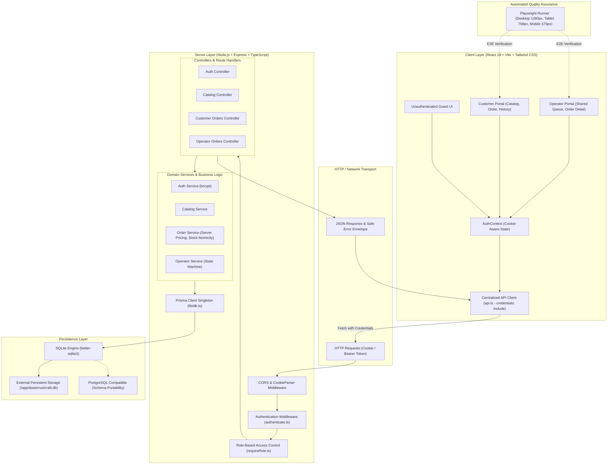
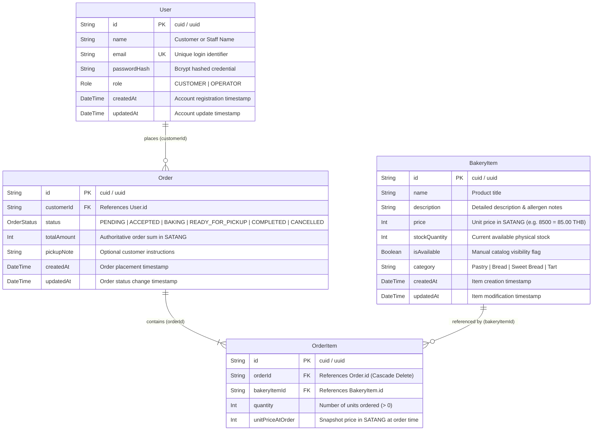

# System-Level Software Design Specification (System SDS)

> **Course:** CPE 334 Introduction to Software Engineering in the Age of AI Agents (Semester 1/2026)  
> **System:** CrustCraft Artisan Bakery Pre-Order & Fulfillment System  
> **Document Version:** `1.0.0` (Sprint 1 Engineering Baseline)  
> **Authors & Co-Developers:**
> - Purin Mebotsom (Student ID: `67070507214`, GitHub: [`@meebotsompurin-stack`](https://github.com/meebotsompurin-stack), Role: `Co-Developer`)
> - Saksorn Buranatananun (Student ID: `67070507208`, GitHub: [`@poom2548`](https://github.com/poom2548), Role: `Co-Developer`)

---

## 1. System Architecture Overview

CrustCraft is engineered as a **Modular Monolith** full-stack web application. The design separates concerns into clean, maintainable logical boundaries while retaining a single repository and cohesive deployment unit, perfectly suited for rapid containerization and cloud orchestration under Google Cloud Platform (GCP).

### 1.1 Architecture Diagrams

#### Mermaid System Topology Diagram


#### ASCII Architecture Diagram
```text
+-----------------------------------------------------------------------------------------+
|                                CLIENT LAYER (React 18 + Vite)                           |
|  [Guest Catalog View]   [Customer Order View]   [Operator Shared Queue View]            |
|                              |                           |                              |
|                              +------------+--------------+                              |
|                                           |                                             |
|                                  [AuthContext.tsx]                                      |
|                                           |                                             |
|                             [services/api.ts (credentials: include)]                   |
+-------------------------------------------|---------------------------------------------+
                                            | HTTP (JSON / Cookies)
+-------------------------------------------v---------------------------------------------+
|                                SERVER LAYER (Express.js + TypeScript)                   |
|  [cors, cookie-parser, express.json]                                                    |
|         |                                                                               |
|  [authenticate.middleware.ts] ------> (Extracts JWT: req.cookies.token || Bearer)       |
|         |                                                                               |
|  [requireRole.middleware.ts] -------> (Enforces: CUSTOMER vs OPERATOR)                  |
|         |                                                                               |
|  +------+-------------------+--------------------+--------------------+                 |
|  | auth.controller.ts       | catalog.controller | orders.controller  | operator.ctrl   |
|  | auth.service.ts          | catalog.service.ts | orders.service.ts  | operator.svc    |
|  +--------------------------+--------------------+--------------------+-----------------+
|                                           |                                             |
|                                [server/src/lib/db.ts] (Prisma Singleton)                |
+-------------------------------------------|---------------------------------------------+
                                            | Prisma ORM (Engine)
+-------------------------------------------v---------------------------------------------+
|                               PERSISTENCE & STORAGE LAYER                               |
|       Local / Cloud: SQLite File on Persistent Volume (/app/data/crustcraft.db)         |
|       (Zero-drift schema ready for PostgreSQL 16 on GCP Cloud SQL / Docker Compose)     |
+-----------------------------------------------------------------------------------------+
```

---

## 2. Component Breakdown & Boundaries

The codebase is organized into four strictly segregated directories, preventing coupling between client presentation, backend domain logic, database operations, and testing harnesses:

```text
crustcraft-bakery-order/
├── client/                     # Frontend Application (React + Vite + Tailwind CSS)
│   ├── src/
│   │   ├── components/         # Reusable presentation widgets (BakeryItemCard, Navbar, etc.)
│   │   ├── context/            # Global application state (AuthContext.tsx)
│   │   ├── pages/              # Routed view containers (CatalogPage, OrderPage, QueuePage)
│   │   ├── services/           # Centralized API network client (api.ts)
│   │   ├── App.tsx             # Route definitions & protected route wrappers
│   │   └── main.tsx            # DOM initialization
│   └── package.json
├── server/                     # Backend API & Domain Logic (Express + TypeScript)
│   ├── src/
│   │   ├── controllers/        # HTTP input parsing, validation & response envelope mapping
│   │   ├── middleware/         # Auth verification, role guards & error handlers
│   │   ├── routes/             # Namespaced route definitions (auth, catalog, customer, operator)
│   │   ├── services/           # Pure business logic (stock validation, pricing, transactions)
│   │   ├── lib/db.ts           # Shared PrismaClient singleton instance
│   │   ├── app.ts              # Express application assembly & middleware chain
│   │   └── server.ts           # HTTP network listener initialization
│   └── package.json
├── prisma/                     # Database Schema, Migrations & Synthetic Seed Data
│   ├── schema.prisma           # Relational schema specification
│   ├── migrations/             # Versioned schema migration SQL histories
│   └── seed.ts                 # Idempotent baseline data seeder
└── e2e/                        # Automated End-to-End Test Suite (Playwright)
    ├── sprint-1/               # User journeys across Desktop, Tablet, and Mobile
    ├── screenshots/            # Verified responsive layout evidence captures
    └── playwright.config.ts    # Multi-browser & multi-viewport test configuration
```

---

## 3. End-to-End Data Flow & Security Protocol

### 3.1 Request Lifecycle & Credential Resolution
1. **Client Dispatch:** The React frontend invokes helper methods in `client/src/services/api.ts`. All outbound network requests include `credentials: 'include'`, automatically attaching the browser's stored `httpOnly` cookie (`token`).
2. **Cookie Parsing:** The Express server processes incoming requests through `cookie-parser`.
3. **Authentication Guard (`authenticate.middleware.ts`):**
   - The middleware inspects `req.cookies.token`. If present, it validates the JWT signature and expiration against the server's `JWT_SECRET`.
   - If the cookie is absent, it falls back to parsing the `Authorization: Bearer <token>` HTTP header, enabling automated API testing via Supertest without simulated browser cookie jars.
   - If valid, the user identity is attached to `req.user = { userId: string, role: Role }`. If invalid or expired, the request is terminated with `401 UNAUTHORIZED`.
4. **Authorization Guard (`requireRole.middleware.ts`):**
   - Endpoints requiring specific privileges apply `requireRole(['OPERATOR'])`. If `req.user.role` does not match, execution halts with `403 FORBIDDEN`.
5. **Business Logic & Persistence:** The controller invokes the appropriate service. For mutating transactions (e.g., pre-order placement), the service wraps operations in `prisma.$transaction`.
6. **Error Envelope Normalization:** If validation fails or a business conflict occurs, the server responds using the mandatory standard error format:
   ```json
   {
     "error": {
       "code": "CONFLICT",
       "message": "Requested item is out of stock.",
       "details": [
         { "field": "items", "issue": "Insufficient stock for Classic Sourdough Loaf" }
       ]
     }
   }
   ```

---

## 4. System Data Model & Entity Relations

All monetary values are modeled as non-negative integer satangs (`Int`, `100 satang = 1.00 THB`) to enforce absolute mathematical precision.

### 4.1 Mermaid Entity-Relationship Diagram


### 4.2 Seeded Baseline Data Specifications
The baseline migration initializes with reproducible synthetic records:
- **Operator Account:** `operator@crustcraft.com` (Role: `OPERATOR`, Password: `operator123`).
- **Customer Accounts:** `customer1@test.com` and `customer2@test.com` (Role: `CUSTOMER`, Password: `customer123`).
- **Standard Bakery Catalog:**
  1. *Artisan Butter Croissant:* Category `Pastry`, Price `8500` satang (฿85.00), Initial Stock `50`, `isAvailable: true`.
  2. *Classic Sourdough Loaf:* Category `Bread`, Price `22000` satang (฿220.00), Initial Stock `20`, `isAvailable: true`.
  3. *Cinnamon Brioche Roll:* Category `Sweet Bread`, Price `6500` satang (฿65.00), Initial Stock `80`, `isAvailable: true`.
  4. *Pain au Chocolat:* Category `Pastry`, Price `9000` satang (฿90.00), Initial Stock `40`, `isAvailable: true`.
  5. *Matcha Almond Tart:* Category `Tart`, Price `14500` satang (฿145.00), Initial Stock `30`, `isAvailable: true`.

---

## 5. Technology Stack Justification

| Architectural Component | Selected Technology | Technical Justification & Evaluation |
|---|---|---|
| **Backend Framework** | Node.js + Express.js (TypeScript) | Proven, lightweight runtime with extensive ecosystem. TypeScript enforces compile-time type safety across API boundaries, contracts, and ORM entity models. |
| **Object-Relational Mapping** | Prisma ORM | Provides automated schema migrations, strictly typed database queries, built-in connection management, and seamless transactional primitives (`prisma.$transaction`). |
| **Database Engine** | SQLite (Dev/Local) & SQLite on Persistent Volume / PostgreSQL (Prod) | SQLite requires zero background daemon configuration, enabling rapid local development and test suite isolation. The relational schema is completely portable to PostgreSQL for enterprise production. |
| **Frontend Framework** | React 18 + Vite (TypeScript) | Declarative UI component hierarchy with instantaneous HMR (Hot Module Replacement) and optimized production bundle compilation. |
| **Styling Framework** | Tailwind CSS | Utility-first styling eliminating external CSS bloat and preventing style regressions. Directly supports mobile-first responsive breakpoints (`sm:`, `md:`, `lg:`). |
| **API & Integration Testing** | Vitest + Supertest | Blazing fast test runner with native TypeScript and ESM compatibility. Supertest facilitates comprehensive HTTP assertion of routes, middleware, and database mutations. |
| **End-to-End Testing** | Playwright | Industry-standard headless browser test automation with first-class multi-viewport emulation and automatic selector waiting, eliminating flaky tests. |

---

## 6. Architecture Decision Records (ADRs)

### ADR-01: GCP Data Persistence & Migration Strategy (Spec 5.1 Compliance)
- **Status:** Accepted
- **Context:** Course Specification Section 5.1 mandates that all persisted application data must survive container restarts, application rebuilds, and cloud redeployments on GCP without data loss.
- **Decision:**
  1. **Primary Cloud Deployment Plan:** Run the containerized CrustCraft application with SQLite, mounting the database file to an external persistent storage volume (`/app/data/crustcraft.db`) provisioned via GCP Compute Engine Persistent Disk or Google Cloud Run Gen2 Persistent Volume Mount.
  2. **Zero-Drift PostgreSQL Portability:** Model all Prisma schema fields using universal relational data types (`String`, `Int`, `Boolean`, `DateTime`). Provide a production-ready `docker-compose.yml` configured with `postgres:16-alpine` and an external named volume (`pgdata`), allowing an instantaneous one-line switch to managed PostgreSQL (e.g., GCP Cloud SQL) should the deployment environment necessitate an external database server.
- **Consequences:** Eliminates external database network latency during local development and testing while guaranteeing full compliance with course persistence rubrics.

### ADR-02: Dual-Channel JWT Authentication, 24h Expiry & Session Revocation
- **Status:** Accepted
- **Context:** Single-page applications face security trade-offs between storing tokens in browser `localStorage` (vulnerable to XSS attacks) and handling automated API testing frameworks (which lack browser cookie jars).
- **Decision:**
  1. **Browser Security:** Successful authentication sets a signed JSON Web Token into an `httpOnly`, `SameSite=Lax`, `Path=/` cookie named `token` with `Max-Age=86400` (24 hours). The frontend `api.ts` dispatches requests using `credentials: 'include'`.
  2. **API Testing Flexibility:** The backend authentication middleware inspects `req.cookies.token` first, but falls back gracefully to `Authorization: Bearer <token>` when headers are provided.
  3. **Revocation & Logout:** `POST /api/auth/logout` explicitly executes `res.clearCookie('token', { httpOnly: true, sameSite: 'lax', path: '/' })`, immediately revoking browser authentication.
- **Consequences:** Completely shields browser session credentials from JavaScript DOM extraction while preserving automated test execution ergonomics in Supertest.

### ADR-03: Monetary Representation as Integer Satang (`Int`)
- **Status:** Accepted
- **Context:** Representing currency using floating-point types (`Float`, `Double`) introduces IEEE 754 precision errors (e.g., `0.1 + 0.2 = 0.30000000000000004`), which can cause severe discrepancies in financial ledgers and order totals.
- **Decision:** All monetary fields (`BakeryItem.price`, `OrderItem.unitPriceAtOrder`, and `Order.totalAmount`) are strictly defined as non-negative integer satangs (`Int`, where `100 satang = 1.00 THB`). Price formatting is applied strictly at the presentation boundary on the client (`(satang / 100).toFixed(2)`).
- **Consequences:** Eliminates floating-point rounding errors across all database aggregations, billing calculations, and financial assertions.

### ADR-04: Separation of `isAvailable` and `stockQuantity` Semantics (`BR-05`)
- **Status:** Accepted
- **Context:** In physical bakeries, products whose daily batch is completely sold out should still be displayed on the public menu to showcase the bakery's specialty offerings, marked clearly as "Out of Stock".
- **Decision:**
  1. `isAvailable` (`Boolean`) is treated exclusively as an operator-managed catalog visibility toggle.
  2. `stockQuantity` (`Int`) tracks remaining physical inventory.
  3. When an item's stock reaches zero, `isAvailable` remains `true`. The catalog API returns the item, the UI displays an `"Out of Stock"` (`สินค้าหมดชั่วคราว`) badge and disables the add-to-order button, and incoming purchase attempts are rejected with `409 CONFLICT`.
- **Consequences:** Protects the bakery's catalog visibility while strictly enforcing real-time inventory guards against overselling.

### ADR-05: Shared Global Operator Queue Architecture (`BR-06`)
- **Status:** Accepted
- **Context:** Boutique artisan bakeries operate with a single integrated kitchen and pickup counter. Workflows require all kitchen and counter staff to share complete visibility over all customer orders.
- **Decision:** All accounts with role `OPERATOR` share a single, storewide global order queue. Orders are not partitioned by individual staff members. Any operator can inspect orders and execute valid state transitions.
- **Consequences:** Aligns system design directly with the single-location artisan bakery domain model, simplifying queue synchronization while establishing robust authorization boundaries between customers and staff.
